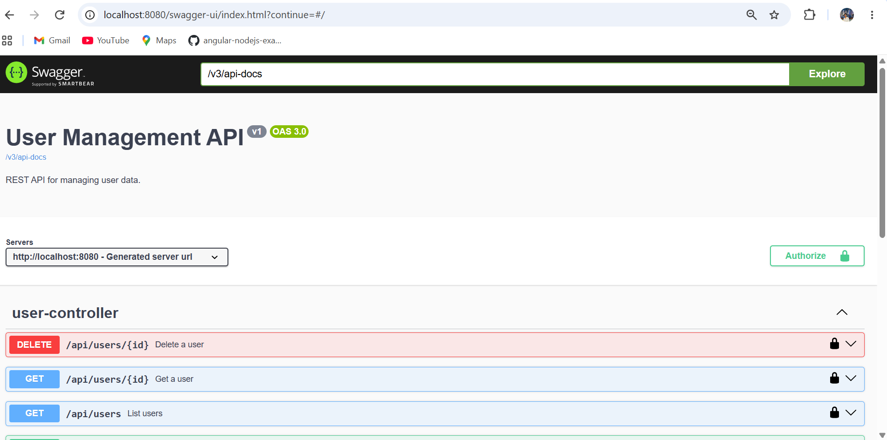
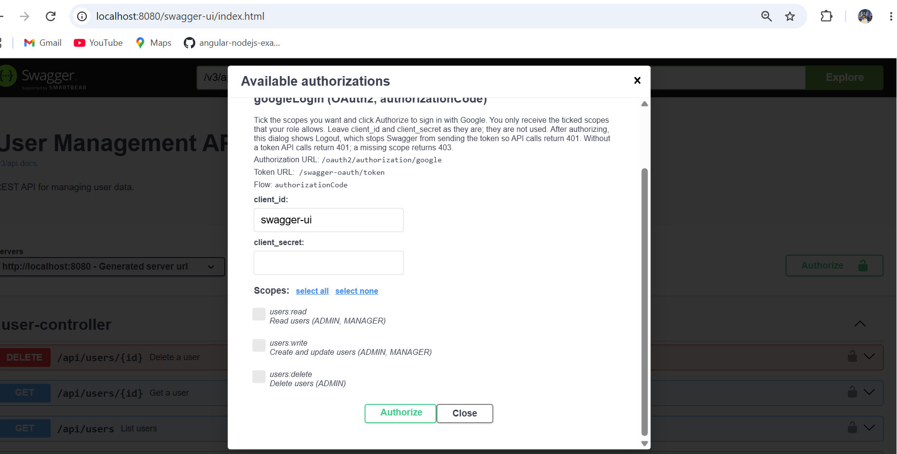
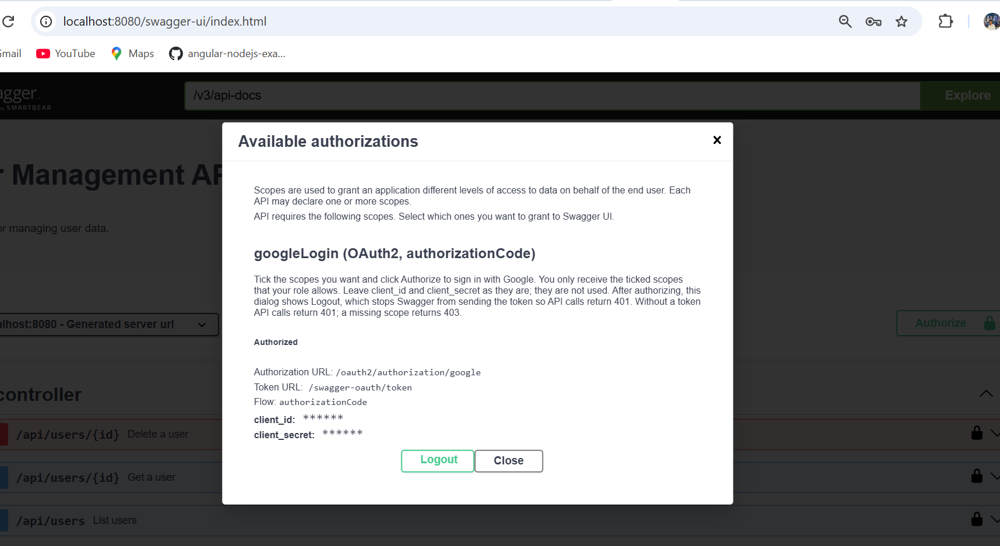
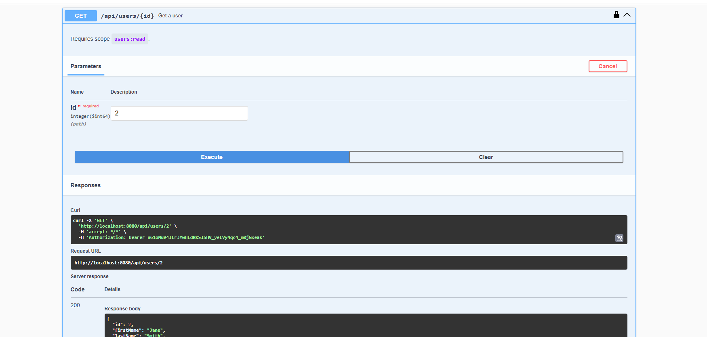

# User Management API

Spring Boot 3 / Java 17 REST API for managing user data (H2 file database, JPA, Bean Validation).

## Run

    mvn spring-boot:run

Server starts on http://localhost:8080. H2 console: http://localhost:8080/h2-console
(JDBC URL `jdbc:h2:file:./data/usersdb`, user `sa`, empty password).

## Swagger UI

| What            | URL                                      |
|-----------------|------------------------------------------|
| Swagger UI      | http://localhost:8080/swagger-ui.html    |
| OpenAPI JSON    | http://localhost:8080/v3/api-docs        |
| Log out (session) | http://localhost:8080/logout           |

Swagger UI and the OpenAPI JSON are only available after signing in with Google, and only to users
whose email is stored in the database with the `ADMIN` or `MANAGER` role.

### Google login setup

1. In Google Cloud Console, create an OAuth client of type **Web application** and add the redirect URI
   `http://localhost:8080/login/oauth2/code/google`.
2. Provide the credentials as environment variables before starting the app:

        GOOGLE_CLIENT_ID=<your client id>
        GOOGLE_CLIENT_SECRET=<your client secret>

3. Make sure an `ADMIN` or `MANAGER` user has your Google email (the sample users use `@example.com`
   addresses), for example in the H2 console:

        UPDATE USERS SET EMAIL = 'you@gmail.com' WHERE ID = 1;

Keep the client secret out of version control.

### Using Swagger UI

**1. Open Swagger UI.** Sign in with Google, then click **Authorize**. The padlock on each endpoint
shows it needs authorization.

**2. Choose scopes.** Tick the scopes you want and click **Authorize**. You only receive the ticked
scopes that your role allows.

**3. Check you are authorized.** The dialog now shows **Authorized** and a **Logout** button. Logout
makes Swagger stop sending its token, so API calls return 401 until you authorize again.

**4. Try an endpoint.** Open an endpoint, click **Try it out** and **Execute**. Each endpoint states the
scope it requires.

## Roles and scopes

Every user has a `role` (`ADMIN`, `USER` or `MANAGER`; new users default to `USER`). The role decides which
scopes a login can receive:

| Scope          | Allows                         | `ADMIN` | `MANAGER` | `USER` |
|----------------|--------------------------------|:-------:|:---------:|:------:|
| `users:read`   | `GET` endpoints                | yes     | yes       | yes    |
| `users:write`  | `POST` and `PUT` endpoints     | yes     | yes       |        |
| `users:delete` | `DELETE` endpoint              | yes     |           |        |

Only `ADMIN` and `MANAGER` users can sign in. A call without a login returns 401, and a call whose
scope is missing returns 403.

## Endpoints

| Method | Path              | Scope          | Description                          |
|--------|-------------------|----------------|--------------------------------------|
| GET    | /api/users        | `users:read`   | List users (`?page=0&size=20&sort=lastName,asc`) |
| GET    | /api/users/{id}   | `users:read`   | Get one user                         |
| POST   | /api/users        | `users:write`  | Create user (201 + Location)         |
| PUT    | /api/users/{id}   | `users:write`  | Update user                          |
| DELETE | /api/users/{id}   | `users:delete` | Delete user (204)                    |

The request body accepts `firstName`, `lastName`, `email`, `phone` and an optional `role`.

Sample users are added on startup if their email is not already stored.

## Example

Calls to `/api` need the token Swagger UI gets from **Authorize**, so the easiest way to try them is the
Swagger UI above. This is the request body for creating a user:

    {"firstName":"Ada","lastName":"Lovelace","email":"ada@example.com","phone":"+44 1234567","role":"USER"}

Errors use RFC 7807 problem details (400 validation, 404 not found, 409 duplicate email).

To use PostgreSQL/MySQL instead, swap the H2 dependency and datasource properties.
